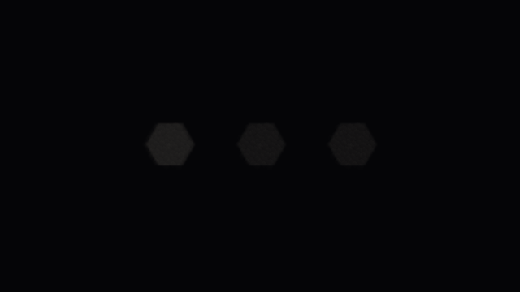
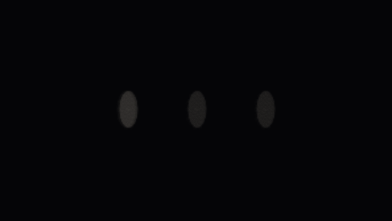
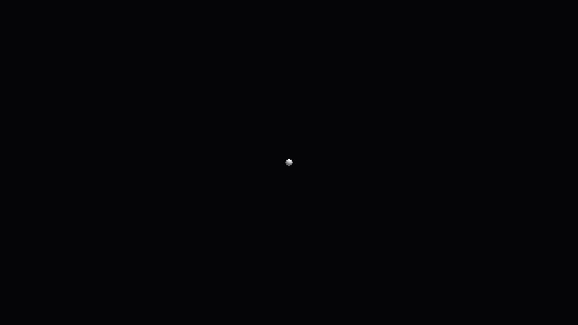
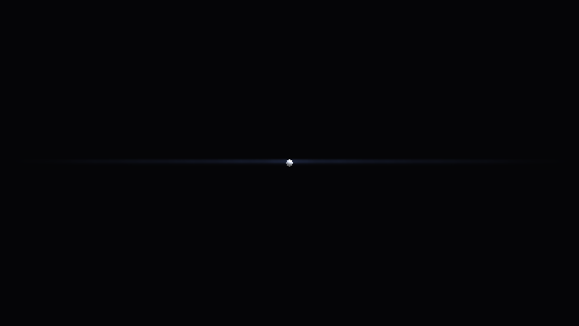
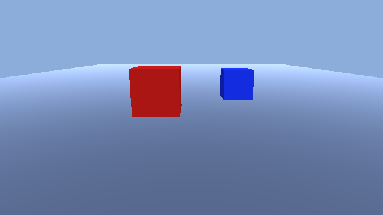
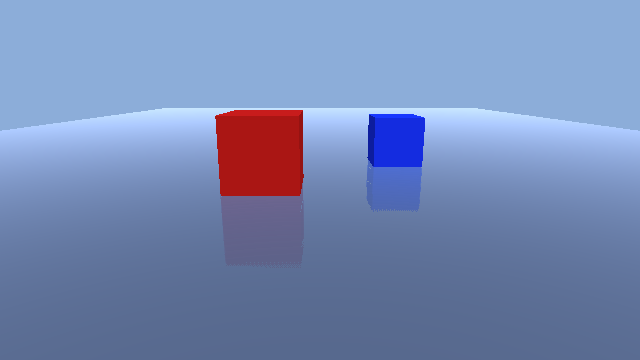
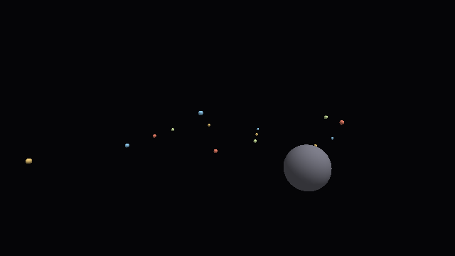
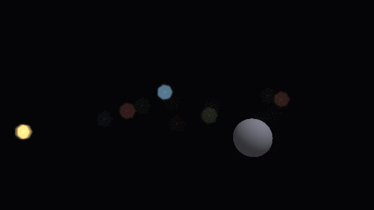
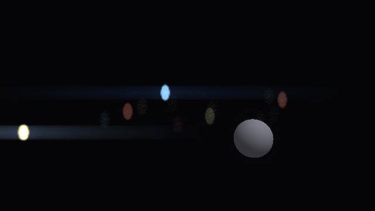

# Rendering tier 4: lens shapes and screen-space effects

| feature | how | file | test |
|---|---|---|---|
| screen-space reflections | a post stage that walks the reflected ray through the depth buffer and replaces the environment's reflection (which the mesh pass already drew) with the hit; a miss keeps the environment | `app/ssr.mojo` | `tests/ssr_native.mojo` |
| bokeh shape | the gather of `DepthOfField` over a polygon aperture (blades, rotation, roundness) narrowed by an anamorphic squeeze; `Bokeh` adds the highlights as aperture-shaped sprites | `app/lens.mojo` | `tests/bokeh_native.mojo` |
| anamorphic streak | the highlights blurred along x only, four passes in half-float targets, tinted and added | `app/lens.mojo` | `tests/bokeh_native.mojo` |

`pixi run -e wasm test-tier4` runs the tests (the parity workflow runs it in CI); `pixi run -e wasm tier4-shots` writes
the reference images to `build/shots/tier4/` (`--docs` copies them to `docs/images/tier4/`).

All numbers below are from lavapipe (Mesa's CPU Vulkan driver) on a 4-core container. Frame times there are CPU
rasteriser times: they rank the stages against each other, they are not GPU times.

## The Frame uniform

Every post stage reads `Frame` (app/post.mojo). It grew from 60 to 88 floats; the new fields are at the end:

| field | read by | set from |
|---|---|---|
| `tone` | `to_linear` / `to_display` in every stage | `set_atmosphere`: the linear workflow's flag and its exposure |
| `ao` | screen-space ambient occlusion (later PR) | `ao_radius`, `ao_intensity`, `ao_temporal` |
| `ssr` | `Ssr` | `ssr_intensity`, `ssr_max_distance`, `ssr_thickness`, `ssr_max_roughness` |
| `bokeh`, `bokeh2` | `DepthOfField`, `Bokeh` | `bokeh_blades`, `bokeh_rotation`, `bokeh_roundness`, `bokeh_squeeze`, `bokeh_gain`, `bokeh_threshold` |
| `streak`, `stint` | `AnamorphicStreak` | `streak_intensity`, `streak_threshold`, `streak_length`, `streak_tint` |

`to_linear` undoes the passes' tone curve (exposure, Narkowicz's ACES fit, 1 / 2.2: app/textures.mojo `atmo_out`) by
solving the fit's quadratic, so a stage can add or remove light in the units the passes lit with; `to_display` applies
it again. With the linear workflow off both return their input.

## Bokeh shape

```mojo
comptime Cine = ThenPost[Bokeh, AnamorphicStreak]
var r = SceneRendererOf[DefaultPasses, Cine](device, format, view)
r.lens_fstop = 1.0
r.bokeh_blades = 6          # 0: round
r.bokeh_rotation = 0.0      # a corner at this angle, counter-clockwise from +x on the screen
r.bokeh_roundness = 0.2     # 0 straight blades, 1 a circle
r.bokeh_squeeze = 1.5       # anamorphic: the discs are 1.5 times taller than wide
r.bokeh_gain = 32.0         # Bokeh: the highlight sprites; 0 none
r.bokeh_threshold = 0.8
```

With the defaults (no blades, squeeze 1) `DepthOfField` runs the round 48-sample gather it had before, unchanged; the
existing tests (`lens_native`, `photo_native`) pass as they did. With blades or a squeeze set it takes 64 samples of the
same spiral, each moved out to the polygon's radius in its direction (`aperture_r`) and narrowed along x by the squeeze.

The gather alone cannot show the shape of a small light: a light of 15 pixels inside a 60-pixel disc covers about 6 % of
the samples, and the colour the passes hand over is tone mapped to at most 1, so it averages to a faint, noisy blot.
`Bokeh` therefore scatters the highlights: one quad per 4 x 4-pixel cell (a half-size grid of 2-pixel cells, through
`Strokes`, app/strokes.mojo), drawn only where the cell is brighter than `bokeh_threshold`. The quad is as large as the
cell's blur disc, cut to the aperture's outline with a one-pixel soft edge, and carries the light above the threshold
times `bokeh_gain`, spread over the outline's area. The sprites add up in a half-size RGBA16Float target (in 8 bits
each of the thousands of faint additions would round), and `BokehMix` adds them to the gathered frame.

`tests/bokeh_native.mojo`, three spheres 20 m away against a dark wall, focus 1 m, `lens_max_coc` 60 px; the outline is
the bokeh's pixels (3 x 3 means above a quarter of the way from the wall to its inside), read along 72 directions from
its centroid:

| setting | measured | expected |
|---|---|---|
| round | 61.75 x 61.75 px, radius max / min 1.076 | 60 px plus the sphere, constant radius |
| 6 blades, rotation 0 | max / min 1.162; correlation of the radius with the hexagon's 0.948, with the hexagon turned 30 deg -0.805 | 1.155 (1 / cos 30 deg), corners at 0, 60, ... deg |
| 6 blades, rotation 30 deg | correlation with the turned hexagon 0.948, with the unturned -0.852 | the corners turn with the rotation |
| 6 blades, roundness 1 | max / min 1.068 | a circle |
| squeeze 2 | 31.75 x 61.75 px, width / height 0.514 | 0.5, widened by the sphere's own size |

 

## Anamorphic streak

```mojo
r.streak_intensity = 0.5    # 0 returns the frame unchanged
r.streak_threshold = 0.85
r.streak_length = 1.0
r.streak_tint = Vec3(0.45, 0.6, 1.0, 0.0)
```

The light above `streak_threshold` at half size (a soft knee of 0.1), blurred along x only by four passes of 9 taps,
1, 3, 9 and 27 pixels of that target apart (times `streak_length`), weights exp(-0.35 |i|). The second pass's output is a
short core, the fourth's the long tail; `StreakSum` adds the core once and the tail 24 times (spread over a third of
the frame the tail would otherwise be a few levels at most: the streak is a look, not an energy balance), and
`StreakMix` adds the result in `streak_tint` times `streak_intensity`. All six intermediate targets are RGBA16Float.

`tests/bokeh_native.mojo`, one bright sphere 10 m away, 640 x 360:

| check | measured |
|---|---|
| intensity 0 | the frame without the effect, 0 pixels differ |
| light added 40 and 80 px along the source's row (sum of both sides' means) | 16.8 levels |
| the same 20 and 40 px along its column | 0 levels |
| how far the streak stays above a tenth of its value 12 px out | 258 px at length 1 (0.40 of the width), 127 px at length 0.5 |

 

## Screen-space reflections

```mojo
comptime Cine = Ssr
var r = SceneRendererOf[DefaultPasses, Ssr, Aux[SurfacePasses]](device, format, view)
r.set_environment(device, sky_environment(...))   # or an EnvProbe: what a ray that misses keeps
r.ssr_intensity = 1.0        # 0 returns the frame unchanged
r.ssr_max_distance = 20.0
r.ssr_thickness = 0.3
r.ssr_max_roughness = 0.6
```

The algorithm, the aux target's channel layout and the approximations are in the header of `app/ssr.mojo`. In short: the
mesh pass has already added the environment's reflection to the colour; the aux target (`SurfacePasses`) records its
luminance, the Fresnel weight, the roughness and metallic; the stage marches the reflected ray (40 steps, 6 halvings),
and on a hit swaps the environment's part for the hit's colour. On a miss the frame is unchanged, so the fallback is the
EnvProbe or gradient reflection. The normal is rebuilt from depth and turned toward the camera.

`tests/ssr_native.mojo`, a glossy floor (roughness 0.05) with a red and a blue box, 640 x 360. Each check runs with the
linear workflow off and on:

| check | linear off | linear on |
|---|---|---|
| intensity 0, pixels differing from the frame without the stage | 0 | 0 |
| floor under the red box: RGB without, with | 100 120 161, 101 99 140 | 134 148 171, 127 104 143 |
| floor under the blue box: RGB without, with | 114 137 182, 78 107 195 | 155 168 187, 74 109 191 |
| floor where rays leave the screen, largest channel difference | 0 | 0 |
| roughness 0.9 (limit 0.6), pixels changed | 0 | 0 |
| `NoAux` (no surface data), pixels changed | 0 | - |

 

Cost, `ssr_native --cost`, 1920 x 1080, median of 9 frames (lavapipe, a CPU rasteriser):

| pipeline | ms / frame | added over one copy stage |
|---|---:|---:|
| one copy stage | 79.37 | - |
| one copy stage + the surface aux pass | 97.09 | +17.72 |
| Ssr + the surface aux pass | 308.49 | +229.12 |

## Cost

`bokeh_native --cost`, 1920 x 1080, the three-sphere scene, median of 9 frames:

| pipeline | ms / frame | added over one copy stage |
|---|---:|---:|
| one copy stage | 37.08 | - |
| DepthOfField, round aperture (48 samples) | 421.79 | +384.70 |
| DepthOfField, 6 blades, squeeze 1.5 (64 samples) | 653.23 | +616.14 |
| Bokeh: the same, plus the highlight sprites (gain 64) | 751.70 | +714.61 |
| AnamorphicStreak (7 stages, 6 half-size targets) | 86.08 | +48.99 |

The shaped gather costs 1.6 times the round one: a third more samples and the outline's trigonometry per sample. The
sprites add about 100 ms here: 130 000 quads are placed (one per cell) and almost all are empty.

## Reference images

`pixi run -e wasm tier4-shots -- --docs`, 640 x 360, in `docs/images/tier4/`:

| file | what |
|---|---|
| `bokeh_round.png`, `bokeh_hexagon.png`, `bokeh_anamorphic.png` | the three spheres with a round, a six-bladed and a squeezed aperture |
| `lens_night_plain.png`, `lens_night_7_blades.png`, `lens_night_anamorphic.png` | a sphere in focus before coloured lights: no lens, seven blades, squeeze 1.8 with the streak |
| `streak_off.png`, `streak_on.png` | one light without and with the streak |

  

## Left open

- The highlight sprites read the tone-mapped colour, so `bokeh_gain` stands in for the range the passes clipped. A scene
  target in half float (tone mapping as the last stage) would let the sprites carry the light the surfaces had.
- Cat's-eye bokeh (the disc cut by the lens barrel toward the frame's edges) and chromatic fringes are not drawn.
